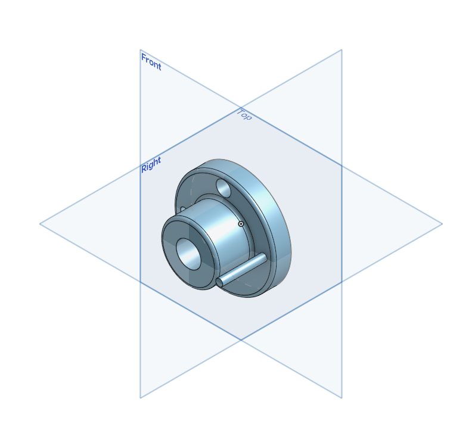
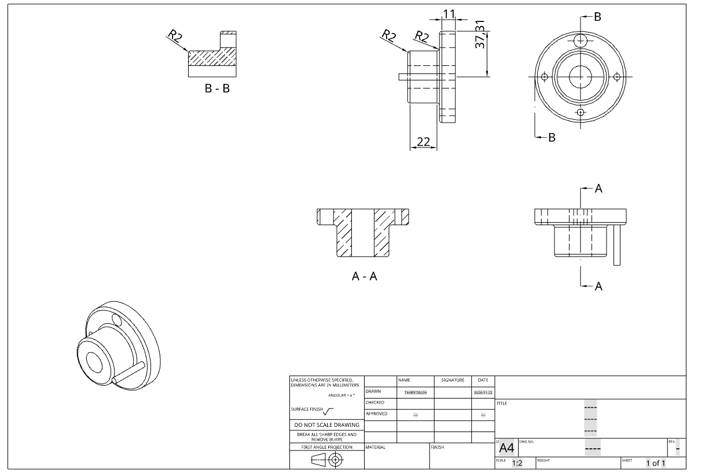
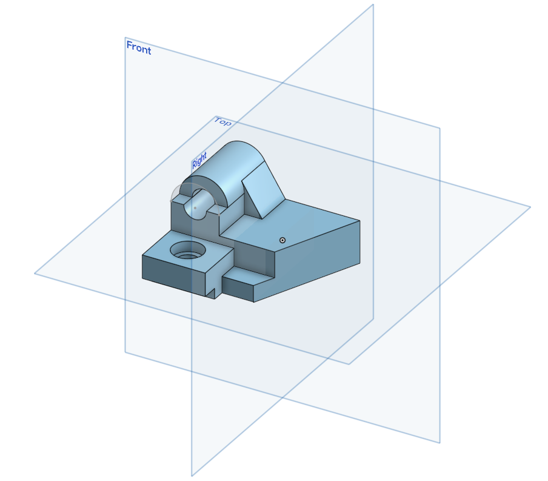
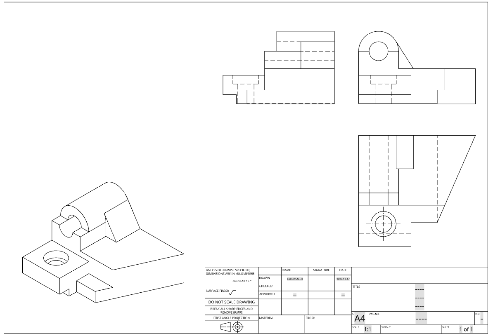
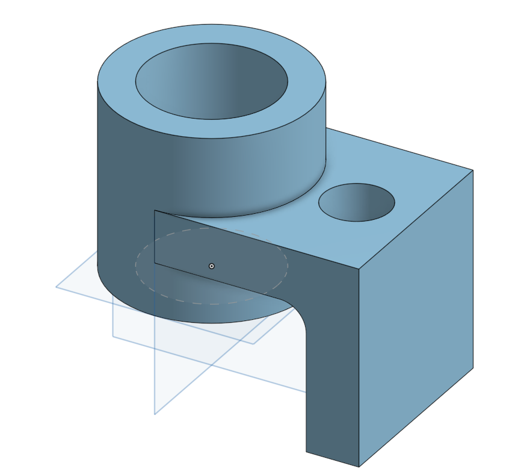

# Onshape CAD Portfolio

A collection of my 3D models, assemblies, and technical drawings created in [Onshape](https://www.onshape.com).

## Featured Projects (More in progress)

### 1. Flanged Cylindrical Housing with Alignment Pin
* **Overview:** Axisymmetric flanged component featuring a central bore, mounting bolt pattern, radial alignment pin, and filleted transitions (`R2`).
* **3D Model:**
  
* **2D Technical Drawing:** First-angle orthographic projection (A4, Scale 1:2) with full cross-sectional views (`A-A`, `B-B`) and metric dimensions.
  

---

### 2. Stepped Shaft Support & Angled Mounting Bracket
* **Overview:** Multi-feature mechanical bracket combining a cylindrical shaft boss, reinforcing gusset rib, counterbored mounting pad, and tapered base plate.
* **3D Model:**
  
* **2D Technical Drawing:** First-angle orthographic projection (A4, Scale 1:1) detailing hidden feature lines, counterbore geometry, and isometric view.
  

---

### 3. Offset Cylindrical Boss & L-Bracket
* **Overview:** Structural L-bracket integrated with a hollow cylindrical sleeve, internal fillet relief, and clearance mounting bore.
* **3D Model:**
  

---

## Quick Tips for Viewing
* Click any of the links to inspect the 3D model directly in your browser (no Onshape account required for view-only).
* Use the tabs at the bottom of the Onshape workspace to switch between **Part Studios**, **Assemblies**, and **2D Drawings**.

1. https://cad.onshape.com/documents/c3769dec6deb949e095c9447/w/536c443f495318de2f4cdbc7/e/830bc7fff16d698765e48897?renderMode=0&uiState=6b03760c0c68db9c2e570546
2. https://cad.onshape.com/documents/0b691ad0a0d00fa933b6a533/w/de10b72106998d726b709a5c/e/2763d32d8ddc53e4a5a972fd?renderMode=0&uiState=6b037e57f4129f69eaccbbff
